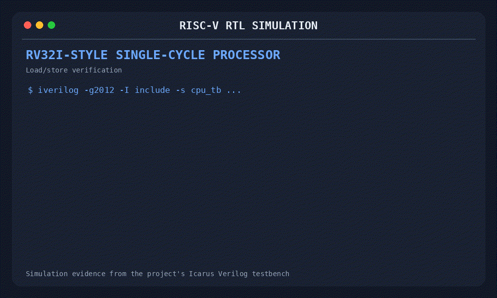
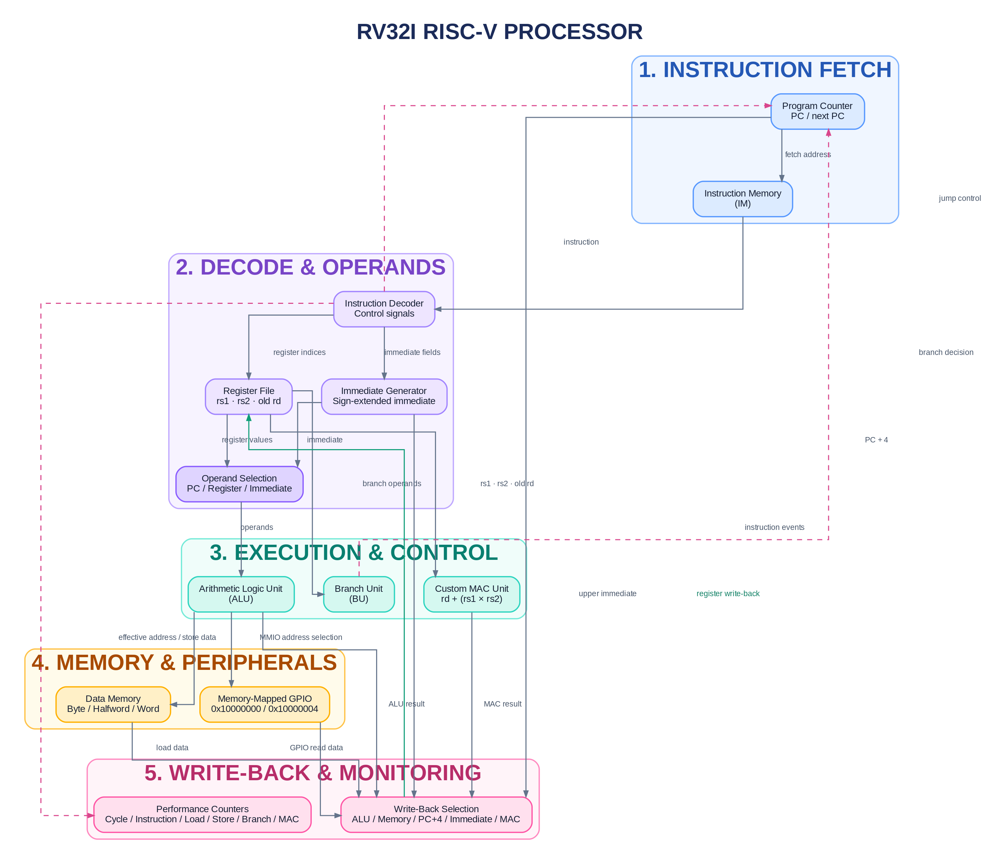
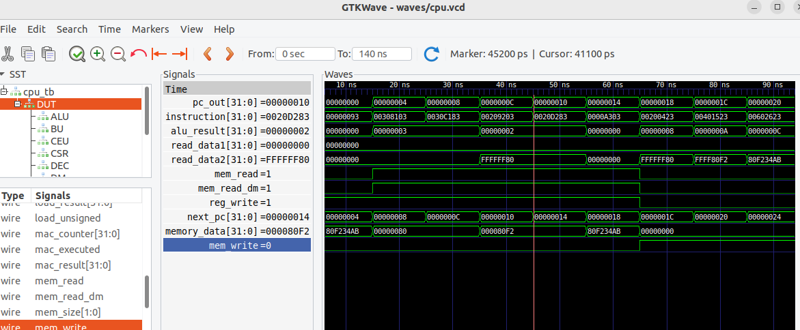

# RV32I RISC-V Processor

A Verilog RTL implementation of a single-cycle RISC-V processor featuring a custom multiply-accumulate (MAC) execution unit, memory-mapped GPIO, and performance counters.

## Key Features

- **Single-cycle datapath:** instruction fetch, decode, execution, memory access, and write-back.
- **RV32I-style instruction processing:** register-based operations, immediate generation, branches, loads, and stores supported by the current RTL.
- **Load/store handling:** byte, halfword, and word accesses, including signed and unsigned loads.
- **Custom MAC unit:** dedicated multiply-accumulate execution logic.
- **Memory-mapped GPIO:** peripheral access through defined memory addresses.
- **Performance counters:** cycle, instruction, load, store, branch, and MAC event counts.
- **Simulation-based verification:** testbench checks for load/store behavior and memory accesses using Icarus Verilog.

## Repository Structure

```text
risc-v-processor/
├── include/
│   └── cpu_defines.v
├── rtl/
│   ├── alu.v
│   ├── branch_unit.v
│   ├── cpu.v
│   ├── csr_unit.v
│   ├── custom_execution_unit.v
│   ├── data_memory.v
│   ├── decoder.v
│   ├── gpio.v
│   ├── immediate_generator.v
│   ├── instruction_memory.v
│   ├── program_counter.v
│   └── register_file.v
├── tb/
│   ├── cpu_tb.v
│   ├── data_memory_tb.v
│   └── ...
├── docs/
│   ├── demo/
│   │   └── cpu_simulation.gif
│   ├── images/
│   │   └── cpu_architecture.png
│   └── waveforms/
│       ├── cpu_execution.png
│       └── cpu_execution2.png
├── sim/
└── README.md
```

### Directory Overview

| Directory | Purpose |
|---|---|
| `rtl/` | Processor datapath, control, memory, GPIO and custom execution RTL |
| `include/` | Instruction encodings, constants and shared definitions |
| `tb/` | Module-level and CPU-level testbenches |
| `sim/` | Compiled simulation executables |
| `waves/` | Generated Value Change Dump (VCD) files |
| `docs/` | Architecture diagram, waveform screenshots and demo GIF |


## Simulation

### Prerequisites

- Icarus Verilog (`iverilog` and `vvp`)
- GTKWave (optional, for waveform inspection)

### Run the CPU testbench

From the project root:

```bash
mkdir -p sim
iverilog -g2012 -I include -s cpu_tb \
  -o sim/cpu_test rtl/*.v tb/cpu_tb.v
vvp sim/cpu_test
```

The current CPU testbench checks supported load and store operations and reports performance-counter values.

### Open the waveform

```bash
gtkwave waves/cpu.vcd waves/cpu_execution2.gtkw
```

## Simulation Demo



*Animated summary of the Icarus Verilog simulation, including load/store
test results and performance counters.*

## Architecture

The processor uses a single-cycle datapath with instruction fetch, decode, execution, memory access, and write-back logic.



## CPU Execution Waveform

The waveform below shows instruction execution in the single-cycle datapath, including program-counter progression, instruction fetch, ALU results, and memory read/write control signals.



## Verification Results

The CPU testbench currently verifies the following load and store instructions.

| Category | Instructions | Result |
|---|---|---|
| Loads | `LB`, `LBU`, `LH`, `LHU`, `LW` | 5/5 passed |
| Stores | `SB`, `SH`, `SW` | Passed |
| Memory | Byte, halfword, and word access checks | Passed in the current tests |

**Sample simulation metrics**

| Metric | Result |
|---|---:|
| Cycles | 13 |
| Instructions | 9 |
| Loads | 5 |
| Stores | 3 |
| Branches | 0 |
| MAC operations | 0 |

These results reflect the current testbench


## 🎬 Demo: Load Word Instruction

This animated walkthrough follows `LW x10, 0(x1)` through the processor, from instruction fetch to register write-back.


**Instruction:** `LW x10, 0(x1)`

- **Fetch:** The PC supplies the instruction address.
- **Decode:** The decoder identifies the load operation and destination register.
- **Read operands:** The register file supplies `x1`; the immediate generator extracts the offset.
- **Calculate address:** The ALU computes `x1 + offset`.
- **Load:** Data memory returns the 32-bit word at the calculated address.
- **Write-back:** The loaded word is written into `x10`.


## At a glance

🖥️ **Single-cycle RISC-V processor**  
Verilog RTL · PC + instruction memory + decode + execute + write-back

---

🧮 **Custom multiply-accumulate instruction**

`rd ← rd + (rs1 × rs2)`

Custom opcode · Dedicated execution logic · MAC result selection at write-back

---

💾 **Load/store datapath**

`LB`, `LBU`, `LH`, `LHU`, `LW` · Byte/halfword/word stores · Load sign or zero extension

---

🔌 **Memory-mapped GPIO**

Output address: `0x10000000` · Input address: `0x10000004`

---

📊 **Internal performance counters**

Cycle · Instruction · Load · Store · Branch · MAC

---

🔀 **Control-flow handling**

Conditional branches · JAL · JALR · Next-PC selection and link-register write-back


## 🏗️ Architecture

The processor uses a single-cycle datapath with instruction fetch, decode, execution, memory access, and write-back logic.


> **Note:** The architecture diagram is a work in progress and will be refined to improve signal routing, arrow clarity, and alignment with the RTL implementation.


