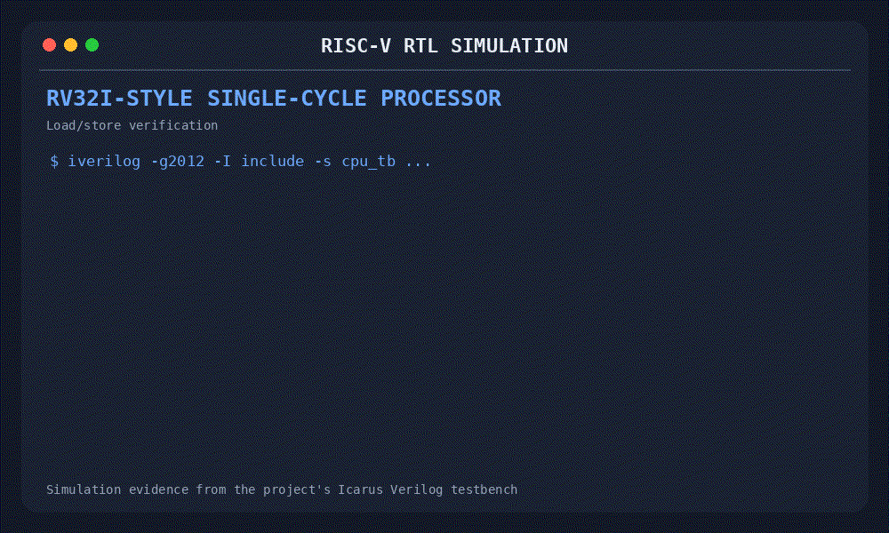
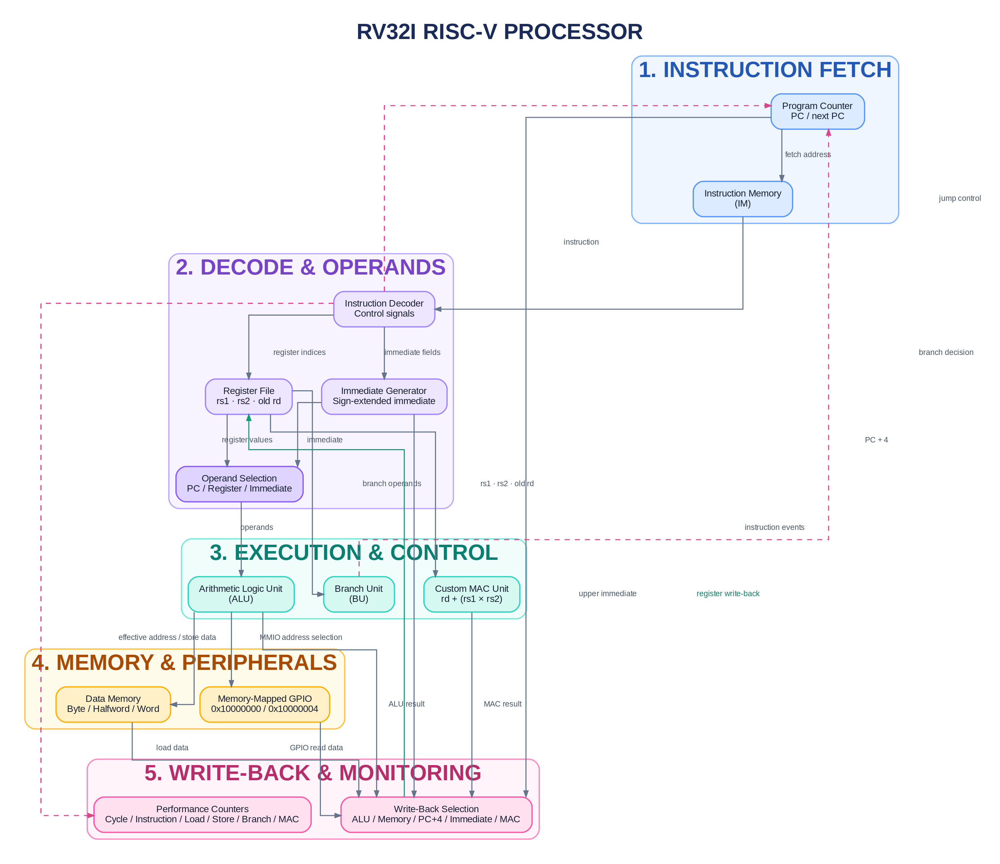
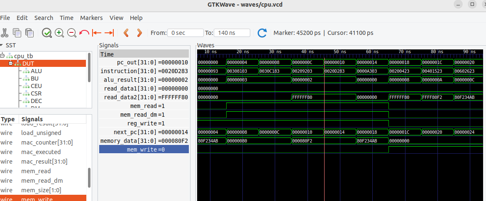
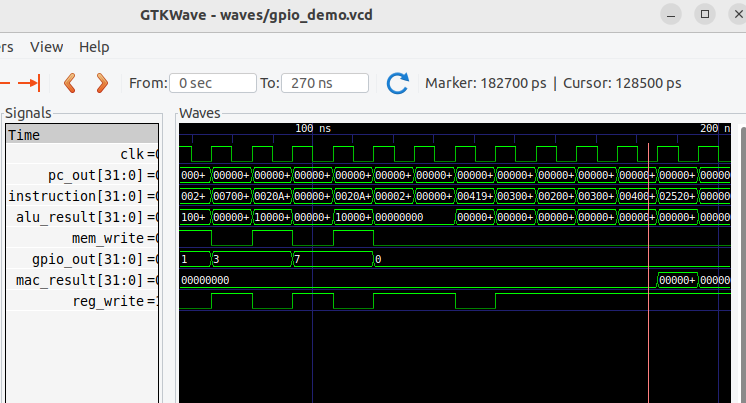
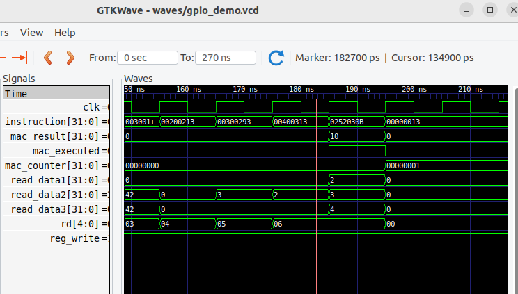
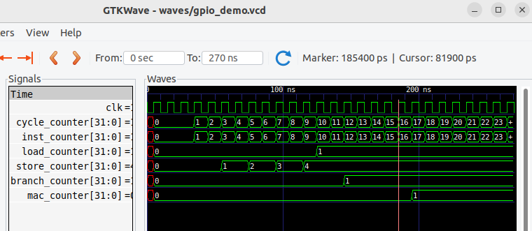

# RV32I RISC-V Processor

A Verilog RTL implementation of a single-cycle RISC-V processor featuring a custom multiply-accumulate (MAC) execution unit, memory-mapped GPIO, and performance counters.

## Key Features

- **Single-cycle datapath:** instruction fetch, decode, execution, memory access, and write-back.
- **RV32I-style instruction processing:** register-based operations, immediate generation, branches, loads, and stores supported by the current RTL.
- **Load/store handling:** byte, halfword, and word accesses, including signed and unsigned loads.
- **Custom MAC unit:** dedicated multiply-accumulate execution logic.
- **Memory-mapped GPIO:** peripheral access through defined memory addresses.
- **Performance counters:** cycle, instruction, load, store, branch, and MAC event counts.
- **Simulation-based verification:** testbench checks for load/store behavior and memory accesses using Icarus Verilog.

## Simulation Demo



*Animated summary of the Icarus Verilog simulation, including load/store
test results and performance counters.*

## 🏗️ Architecture

The processor uses a single-cycle datapath with instruction fetch, decode, execution, memory access, and write-back logic.




## 🎬 Demo: Load Word Instruction

This animated walkthrough follows `LW x10, 0(x1)` through the processor, from instruction fetch to register write-back.


**Instruction:** `LW x10, 0(x1)`

- **Fetch:** The PC supplies the instruction address.
- **Decode:** The decoder identifies the load operation and destination register.
- **Read operands:** The register file supplies `x1`; the immediate generator extracts the offset.
- **Calculate address:** The ALU computes `x1 + offset`.
- **Load:** Data memory returns the 32-bit word at the calculated address.
- **Write-back:** The loaded word is written into `x10`.

## CPU Execution Waveform

The waveform below shows instruction execution in the single-cycle datapath, including program-counter progression, instruction fetch, ALU results, and memory read/write control signals.



## 📁 Repository Structure

```text
risc-v-processor/
├── include/
│   └── cpu_defines.v
├── rtl/
│   ├── alu.v
│   ├── branch_unit.v
│   ├── cpu.v
│   ├── csr_unit.v
│   ├── custom_execution_unit.v
│   ├── data_memory.v
│   ├── decoder.v
│   ├── gpio.v
│   ├── immediate_generator.v
│   ├── instruction_memory.v
│   ├── program_counter.v
│   └── register_file.v
├── tb/
│   ├── alu_tb.v
│   ├── branch_unit_tb.v
│   ├── cpu_tb.v
│   ├── csr_unit_tb.v
│   ├── data_memory_tb.v
│   ├── decoder_tb.v
│   ├── gpio_demo_tb.v
│   ├── immediate_generator_tb.v
│   ├── instruction_memory_tb.v
│   ├── program_counter_tb.v
│   ├── register_file_tb.v
│   └── ...
├── docs/
│   ├── demo/
│   │   ├── lw_instruction_journey.gif
│   │   ├── cpu_simulation.gif
│   │   ├── simulation_summary.txt
│   │   ├── create_demo.sh
│   │   └── make_gif.py
│   ├── images/
│   │   ├── cpu_architecture.png
│   │   ├── cpu_architecture.svg
│   │   ├── cpu_architecture.dot
│   │   ├── gpio_waveform.png
│   │   ├── mac_result.png
│   │   └── performance_counters.png
│   └── waveforms/
│       ├── cpu_execution.png
│       └── cpu_execution2.png
└── README.md
```

### Directory Overview

| Directory | Purpose |
|---|---|
| `rtl/` | Processor datapath, control, memory, GPIO and custom execution RTL |
| `include/` | Shared processor definitions and constants |
| `tb/` | Module-level and CPU-level Verilog testbenches |
| `docs/` | Architecture diagrams, simulation waveforms and demonstration GIFs |

## 🧪 Verification & Testing

The processor is verified using Verilog testbenches, automated functional checks, and GTKWave simulation traces. Verification covers instruction execution, memory operations, custom MAC functionality, memory-mapped GPIO, and performance counters.

### ✅ Instruction Regression Testing

The main CPU regression testbench runs automated functional checks against the implemented processor behavior.

**Regression results:**
- **61 checks passed**
- **0 failures**

Run the regression testbench:

```bash
iverilog -g2012 -I include -s cpu_tb \
  -o sim/cpu_test rtl/*.v tb/cpu_tb.v && vvp sim/cpu_test
```

### 🔌 Memory-Mapped GPIO Verification

A focused CPU demonstration verifies memory-mapped GPIO writes alongside load execution and other processor operations.

The test program produces the following GPIO output sequence:

**`1 → 3 → 7 → 0`**

The waveform shows GPIO output updates during processor execution.



### 🧮 Custom MAC Instruction Verification

The processor supports a custom multiply-accumulate instruction that computes:

**`rd_new = rd_old + (rs1 × rs2)`**

The focused testbench verifies the following operation:

- First source operand: `2`
- Second source operand: `3`
- Previous destination value: `4`
- Computed result: `4 + (2 × 3) = 10`
- Destination register: `x6`

The simulation confirms that `x6 = 10`.



### 📊 Performance Counter Verification

The processor includes internal counters that track execution activity. The focused testbench checks the load, store, branch, and MAC counters and reports the following values:

| Performance Metric | Observed Count |
|---|---:|
| Clock cycles | 24 |
| Instructions | 24 |
| Load operations | 1 |
| Store operations | 4 |
| Taken branches | 1 |
| MAC operations | 1 |

The waveform illustrates the counters incrementing during program execution.




## ▶️ Running the Simulations

This project uses Icarus Verilog for compilation and simulation, with GTKWave for waveform inspection.

### Prerequisites

- Icarus Verilog (`iverilog`, `vvp`)
- GTKWave (optional, for waveform viewing)

### CPU Regression Test

```bash
mkdir -p sim

iverilog -g2012 -I include -s cpu_tb \
  -o sim/cpu_test rtl/*.v tb/cpu_tb.v

vvp sim/cpu_test
```

### GPIO Demonstration

```bash
mkdir -p sim

iverilog -g2012 -I include -s gpio_demo_tb \
  -o sim/gpio_demo rtl/*.v tb/gpio_demo_tb.v

vvp sim/gpio_demo
```

### View Waveforms

```bash
gtkwave waves/gpio_demo.vcd
```

The simulation testbenches generate VCD waveform files in the `waves/` directory for inspection using GTKWave.

```
## 🛠️ Tools & Technologies

| Category | Tools |
|---|---|
| Hardware Description Language | Verilog |
| Simulation | Icarus Verilog |
| Waveform Analysis | GTKWave |
| Development Environment | Visual Studio Code |
| Version Control | Git and GitHub |
| Operating System | Ubuntu Linux |


